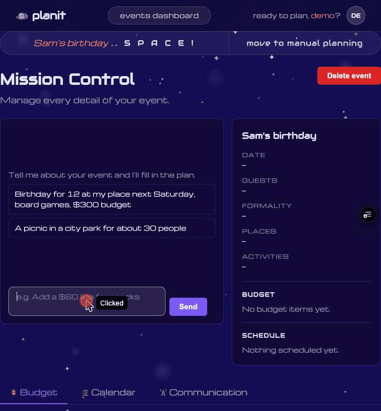

# Planit

An event planning app built to help users organize, budget, and communicate around events — from casual hangouts to larger gatherings.

## Tech Stack

### Frontend
- **Angular 21** — component framework (standalone components, no NgModule)
- **TypeScript 5.9** — strict mode enabled
- **RxJS 7.8** — reactive state and async handling
- **CSS3** — custom design system with CSS variables, no UI library

### Backend
- **Supabase** — authentication and database (PostgreSQL)
- **Vercel Functions** — `api/agent.ts`, the planning agent's server side
- **Claude API** — the model behind the planning agent, via the Anthropic TypeScript SDK

### Testing
- **Vitest** — unit test runner
- **JSDOM** — DOM simulation for tests

### Code Quality
- **Prettier** — code formatting with Angular HTML support

### Design
- **Figma** — UI/UX design and flow mockups
- **Icons** — the SVGs in `public/icons/` are from Moonpunch Studio's [Sci-Fi Icons](https://moonpunchstudio.itch.io/scifi-icons) pack on itch.io

### AI Assistance
- **Claude (Anthropic)** — used throughout development for code generation, architecture decisions, and iterative UI building via [Claude Code](https://claude.ai/code)

## Agent

Mission Control has a planning assistant. You describe the event in plain words, and it fills in the plan: date, guests, formality, places, activities, budget and schedule. The Plan card and the Budget and Calendar tabs update as each change lands.



To retake the GIF after UI changes, run `/demo-gif` in [Claude Code](https://claude.ai/code). The steps are in `.claude/skills/demo-gif/SKILL.md`. It records the same prompt on the Vercel preview with Claude in Chrome, so only the UI changes between takes.

**How it works**
- The browser posts the message to `api/agent.ts`, a Vercel function. It checks the user's Supabase login and loads the event **as that user**, so row-level security applies.
- `runAgent` (`src/app/shared/agent.ts`) sends the plan and the message to Claude (`claude-opus-5-5`, low effort) with **8 tools**: `set_basics`, `choose_places`, `choose_activities`, `add_budget_item`, `remove_budget_item`, `add_schedule_item`, `remove_schedule_item` and `check_schedule_item`.
- The schedule holds both the event day's timeline and the host's to-dos leading up to it (order the cake a week ahead, pick it up the morning of). The Calendar tab shows the event day beside a week-by-week calendar, with a checkbox on every item.
- Every tool call goes through `applyTool` (`src/app/shared/plan.ts`), which validates it. A bad call, such as an id that isn't in the list, goes back to the model as an error it can fix, and the plan only changes on success. Edits made by hand in the tabs go through the same tools.
- The reply and each plan change stream back to the browser as they happen, and the final plan is saved to Supabase.

**Guardrails**
- At most 6 model rounds per message, messages under 2,000 characters, and a cap on conversation length.
- **20 runs per user per day**, counted from the `agent_runs` log. Users can read their own rows there but can't write or delete them.
- Every run is logged with its tokens, tool calls, stop reason, latency and any error.
- The system prompt is cached and stays the same between requests. Today's date and the current plan go in the user message instead.

**Evaluated** with scripted cases against the real model: **12/12 passed** on Oct 28, 2026, before 2 cases for to-dos were added (both pass). See [TESTING.md](TESTING.md).

## Development

Start the local dev server:

```bash
ng serve
```

Open `http://localhost:4200/`. The app reloads automatically on file changes.

## Building

```bash
ng build
```

Build artifacts go to `dist/`.

## Testing

```bash
ng test          # unit tests
npm run eval     # agent eval against the real model (about $0.65)
```

See [TESTING.md](TESTING.md) for what each layer covers and how the agent eval works.

## Project Structure

```
src/
  app/
    pages/        # Home, Signup, Event Flow (1–3), Dashboard
    components/   # Nav, Stepper, Star Field
    core/         # Services, guards, Supabase client
```
